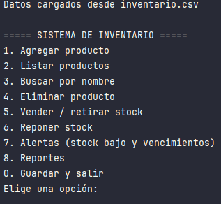
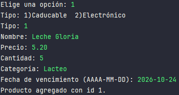
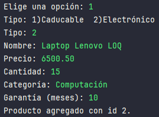
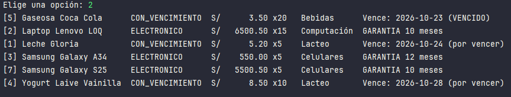
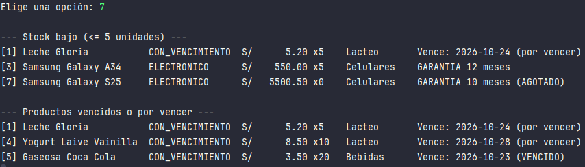
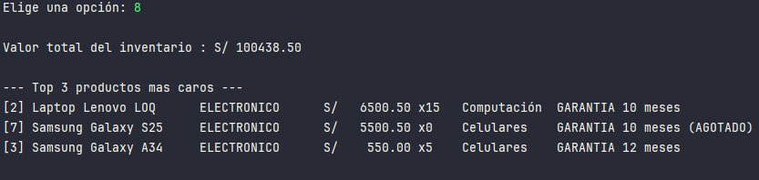

# Sistema de Gestión de Inventario para Almacén (Java)

Aplicación de consola para controlar las existencias de un almacén pequeño o mediano: registrar productos, vigilar el
stock, detectar mercadería próxima a vencer y consultar reportes del valor del inventario.

Proyecto de práctica desarrollado en Java aplicando Programación Orientada a Objetos.

## Caso de uso

Un almacén necesita saber qué tiene, cuánto le queda y qué está por perderse. Esta aplicación responde a esas preguntas:

- ¿Qué productos están por agotarse y deben reponerse?
- ¿Qué mercadería vence pronto o ya venció?
- ¿Cuánto vale el inventario actual?
- ¿Cuáles son los productos más caros y cómo se reparten por categoría?

## Funcionalidades

- Registrar, listar, buscar por nombre y eliminar productos
- Dos tipos de producto: **con vencimiento** (alimentos, medicinas) y **electrónicos** (con garantía)
- Vender (retirar) y reponer stock, con validación de cantidades
- Alertas de **stock bajo** (5 unidades o menos) y de productos **vencidos o por vencer** (7 días o menos)
- Los productos sin existencias se marcan como (**AGOTADO**)
- Reportes: valor total del inventario, top 3 de productos más caros y productos por categoría
- Guardado y carga automática de datos en un archivo CSV

## Conceptos de POO aplicados

| Concepto                   | Dónde se ve                                                             |
|----------------------------|-------------------------------------------------------------------------|
| Clase abstracta            | `Producto`                                                              |
| Herencia                   | `ProductoConVencimiento` y `ProductoElectronico` extienden `Producto`   |
| Polimorfismo               | `getTipo()` y `getDetalle()` cambian según el tipo de producto          |
| Interfaz                   | `Vencible`, con métodos `default` para calcular el estado de vencimiento |
| Encapsulamiento            | Atributos privados y validaciones en constructores y setters            |
| Excepciones personalizadas | `StockInsuficienteException` y `ProductoNoEncontradoException`          |
| Colecciones y Streams      | `Inventario` (filtros, ordenamientos y agrupación con `groupingBy`)     |
| Entrada/salida de archivos | `ArchivoInventario` (`java.nio.file`)                                   |

## Estructura del proyecto

```
src/main/java/com/inventario/
├── app/             Main: menú por consola
├── modelo/          Producto, ProductoConVencimiento, ProductoElectronico, Categoria, Vencible
├── servicio/        Inventario: lógica de negocio y reportes
├── almacenamiento/  ArchivoInventario: guardado y carga en CSV
└── excepciones/     Excepciones personalizadas
src/test/java/       Pruebas unitarias con JUnit 5
```

## Cómo ejecutarlo

Requisitos: JDK 17 o superior.

1. Clona el repositorio.
2. Ábrelo en IntelliJ IDEA (el `pom.xml` configura Maven y JUnit).
3. Ejecuta la clase `Main` (`src/main/java/com/inventario/app/Main.java`).

Al elegir la opción **0** (guardar y salir), los datos se guardan en `inventario.csv` y se cargan al iniciar la
siguiente vez.

**Pruebas unitarias:** clic derecho sobre `src/test/java` -> *Run`All tests`*.

## Capturas

**Menú**



**Agregar un producto**





**Listado**



**Alertas de stock bajo y vencimientos**



**Reportes**



## Alcance y limitaciones

Es un proyecto de aprendizaje, no un sistema listo para producción:

- Funciona por consola y con un solo usuario.
- Los datos se guardan en un archivo CSV, sin base de datos.
- No registra el historial de movimientos (quién vendió o repuso, y cuándo).
- El stock mínimo (`STOCK_MINIMO`) y los días de alerta (`DIAS_ALERTA`) son constantes en el código.

## Hoja de ruta

Este proyecto avanza por etapas. La versión actual usa **solo Java y POO**, y las siguientes lo llevarán a una
aplicación más completa:

| Versión | Estado   | Contenido                                                                                 |
|---------|----------|-------------------------------------------------------------------------------------------|
| v1      | Actual   | Aplicación de consola con POO, colecciones, Streams, excepciones, CSV y pruebas con JUnit |
| v2      | Planeada | Almacenamiento en base de datos (JDBC)                                                    |
| v3      | Planeada | Migración a Spring y Spring Boot, con API REST y login de usuarios                       |

## Posibles mejoras

- Login con usuario y contraseña, con roles (administrador y empleado)
- Historial de movimientos de entrada y salida, registrando qué usuario los hizo
- Proveedores asociados a cada producto
- Edición de productos desde el menú
- Exportación de reportes a archivo

## Autor

**Daniel Aurelio Peralta Escurra** · [LinkedIn](https://www.linkedin.com/in/daniel-peralta-escurra) · [GitHub](https://github.com/Dante-dev-back)


